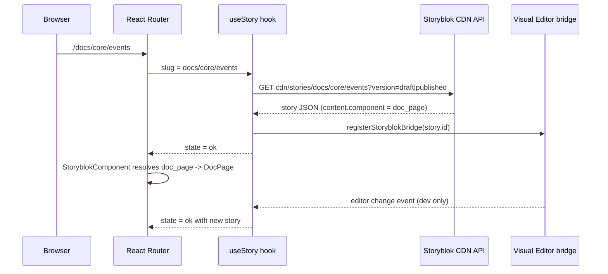

# Kitewoof Docs: a Storyblok + React reference implementation

A documentation site built with React 19, Vite, React Router 7, and Storyblok as a headless CMS. The repository exists as a primer for React engineers who have not used Storyblok before. It shows the minimum set of pieces a real integration needs: a component map, a story fetch, Visual Editor live preview, rich text rendering, and token handling that keeps draft content out of production.

## What Storyblok does in this project

Storyblok holds the content and the content schema. React holds the rendering. The two are joined by a naming contract.

| Concern | Where it lives | Owned by |
|---|---|---|
| Block schemas (field names and types for `doc_page`, `callout`, `code_block`, etc.) | The Storyblok space | Engineers |
| Page content and page composition (which blocks, in what order, with what values) | The Storyblok space | Editors |
| Site navigation (header links, sidebar groups) | A single `config` story in Storyblok | Editors |
| React components that render each block | `src/storyblok/components/` | Engineers |
| The map from block name to React component | `src/storyblok/components.ts` | Engineers |

An editor can only use blocks that already have a React counterpart. Adding a new kind of section is a dev task on both sides.

Reference: [Blocks concept](https://www.storyblok.com/docs/concepts/blocks), [Content Delivery API v2](https://www.storyblok.com/docs/api/content-delivery/v2)

## Request flow



## Repository layout

```
src/
  main.tsx                    storyblokInit: token, region, component map
  App.tsx                     React Router: Layout wrapper + catch-all route
  layout/
    Layout.tsx                fetches the `config` story, renders Header + Sidebar
    Header.tsx                renders site_config.header_links
    Sidebar.tsx               renders site_config.sidebar_groups
  pages/
    CatchAllPage.tsx          pathname -> slug -> useStory -> StoryblokComponent
    NotFoundPage.tsx
  storyblok/
    env.ts                    token selection by build mode, region, version
    components.ts             block name -> React component map
    types.ts                  TypeScript types for every block and field type
    useStory.ts               fetch + bridge registration + loading/404/error state
    richText.ts               rich text node override maps
    richTextNodes.tsx         custom renderers for headings, lists, links, code
    tokenize.ts               lightweight syntax highlighter for code_block
    components/               one file per Storyblok block
      DocPage.tsx             content type (root of a page story)
      SiteConfig.tsx          content type (root of the config story)
      RichText.tsx
      Callout.tsx
      DataTable.tsx
      CodeBlock.tsx
      NavGroup.tsx
      NavLink.tsx
  components/                 plain React components with no Storyblok coupling
    Breadcrumbs.tsx
    PageHeader.tsx
  styles/index.css            custom CSS, no framework
vite.config.ts                fails production builds without a public token
netlify.toml                  SPA redirect, asset caching, env var notes
.env.example                  the three variables the app reads
```

## How the pieces fit

### 1. Initialization

`src/main.tsx` calls `storyblokInit` once before React mounts. It passes the access token, the API region, the `apiPlugin` (which creates the API client), and the component map.

```ts
storyblokInit({
  accessToken: storyblokAccessToken,
  use: [apiPlugin],
  apiOptions: {
    region: storyblokRegion,
  },
  components,
});
```

Reference: [storyblokInit](https://www.storyblok.com/docs/packages/storyblok-react#storyblokinit), [the region parameter](https://www.storyblok.com/docs/libraries/js/js-sdk#the-region-parameter)

### 2. The component map

`src/storyblok/components.ts` is the contract. Keys are the technical names of blocks in the Storyblok space. Values are React components.

```ts
export const components = {
  doc_page: DocPage,
  site_config: SiteConfig,
  rich_text: RichText,
  callout: Callout,
  data_table: DataTable,
  code_block: CodeBlock,
  nav_group: NavGroup,
  nav_link: NavLink,
};
```

Two of these (`doc_page`, `site_config`) are content types, meaning they are the root block of a story. The rest are nestable blocks that editors place inside a `body` or `links` field.

### 3. Fetching a story

`src/storyblok/useStory.ts` is a small hook that wraps the API client. It is the only place the app talks to Storyblok.

- Calls `storyblokApi.get('cdn/stories/<slug>', { version })` where `version` is `draft` in development and `published` in production.
- Returns a discriminated union: `loading`, `ok`, `notfound`, or `error`. A 404 from the API becomes the `notfound` state so the page can render a proper 404.
- Resets to `loading` when the slug changes so stale content never flashes during navigation.
- After a successful fetch, calls `registerStoryblokBridge(story.id, callback)` so edits in the Visual Editor replace the story in state without a reload.

```ts
storyblokApi
  .get(`cdn/stories/${slug}`, { version: storyblokVersion })
  .then(({ data }) => {
    const story = data.story as ISbStoryData<T>;
    setState({ status: 'ok', story });
    registerStoryblokBridge(story.id, (next) => {
      setState({ status: 'ok', story: next as ISbStoryData<T> });
    });
  });
```

Reference: [useStoryblokApi](https://www.storyblok.com/docs/packages/storyblok-react#usestoryblokapi), [Storyblok Bridge](https://www.storyblok.com/docs/libraries/js/preview-bridge)

### 4. Routing

`App.tsx` registers a single catch-all route under a `Layout` wrapper. `CatchAllPage` turns the pathname into a slug (`/` becomes `home`, `/docs/core/events` becomes `docs/core/events`), fetches it, and hands the story's root block to `StoryblokComponent`.

```tsx
<StoryblokComponent
  blok={state.story.content}
  path={slug === 'home' ? '' : slug}
/>
```

`StoryblokComponent` looks up `blok.component` in the map and renders the match. Any extra props (`path` here, `variant` on nav links) are forwarded to the resolved component.

Storyblok folders map directly to URL paths. An editor creating `docs/core/events` in the space creates that route on the site. No code change is needed per page.

Reference: [StoryblokComponent](https://www.storyblok.com/docs/packages/storyblok-react#storyblokcomponent)

### 5. Rendering nested blocks

`DocPage.tsx` is a content type component. It renders page chrome and then delegates each child in `blok.body` back to `StoryblokComponent`.

```tsx
<article className="doc-page" {...storyblokEditable(blok)}>
  <div className="doc-page__body">
    {blok.body?.map((child) => (
      <StoryblokComponent key={child._uid} blok={child} />
    ))}
  </div>
</article>
```

This recursion is the whole pattern. Every block component spreads `storyblokEditable(blok)` onto its root element, which attaches the data attributes the Visual Editor uses to highlight and select blocks.

Reference: [storyblokEditable](https://www.storyblok.com/docs/packages/storyblok-react#storyblokeditable)

### 6. Global site config as a story

Navigation is not hard-coded. `Layout.tsx` fetches a story at slug `config` whose root block is `site_config`, with fields for site name, logo, `header_links`, and `sidebar_groups`. `Header` and `Sidebar` read from that blok and render the nested `nav_link` and `nav_group` blocks through `StoryblokComponent`.

`SiteConfig.tsx` exists so that opening the `config` story in the Visual Editor shows editors a preview of the lists they are editing rather than a blank page.

### 7. Rich text

Storyblok stores rich text as a JSON document, not HTML. The SDK's `StoryblokRichText` component renders it, and `richText.ts` passes node override maps so headings, paragraphs, lists, inline code, and links emit the class names the stylesheet already uses. Internal links resolve to React Router `Link` elements, external ones to plain anchors.

```ts
export const sectionRichText: StoryblokReactRichTextComponentMap = {
  ...shared,
  heading: SectionHeading,
  paragraph: SectionParagraph,
};
```

The two maps (`sectionRichText`, `calloutRichText`) differ only in paragraph styling, which is how the same field type gets different presentation in a `rich_text` block versus a `callout` body.

Reference: [StoryblokRichText](https://www.storyblok.com/docs/packages/storyblok-react#storyblokrichtext)

### 8. Field types worth knowing

`types.ts` hand-writes a TypeScript type per block. A few Storyblok field shapes appear there that are not obvious from the editor UI:

| Field type | Shape in API | Used by |
|---|---|---|
| Blocks | Array of nested bloks, each with `_uid` and `component` | `doc_page.body`, `site_config.sidebar_groups` |
| Multilink | `{ linktype, cached_url, url, email, target }` | `nav_link.link` |
| Asset | `{ filename, alt, ... }` | `site_config.logo` |
| Table | `{ thead: [...], tbody: [{ body: [...] }] }` | `data_table.table` |
| Rich text | ProseMirror-style JSON document | `rich_text.content`, `callout.content` |

`NavLink.tsx` shows how to branch on `linktype` so story links become router navigation while URL and email links become anchors.

## Tokens and environments

The app reads three variables, documented in `.env.example`:

| Variable | Purpose | Where it is set |
|---|---|---|
| `VITE_STORYBLOK_PREVIEW_TOKEN` | Returns draft and published content. Used in `npm run dev` and inside the Visual Editor | `.env.local` only |
| `VITE_STORYBLOK_PUBLIC_TOKEN` | Returns published content only. Required by `npm run build` | `.env.local` and the host's build environment |
| `VITE_STORYBLOK_REGION` | `eu`, `us`, `ap`, `ca`, or `cn`, matching the space | Both |

`src/storyblok/env.ts` picks the token and the `version` parameter from `import.meta.env.PROD`, so a production bundle never contains the preview token. `vite.config.ts` throws during a production build if the public token is missing, which turns a silent runtime failure into a build failure.

Vite inlines `VITE_` variables into the bundle. The preview token can read unpublished drafts, so it must never be set in a production build environment. `netlify.toml` repeats this warning for anyone configuring the host.

Reference: [Access tokens](https://www.storyblok.com/docs/concepts/access-tokens)

## Local development and the Visual Editor

```bash
nvm use
npm install
cp .env.example .env.local
# fill in the tokens and region
npm run dev
```

The Visual Editor loads the site in an iframe and requires HTTPS. `vite-plugin-mkcert` generates a local certificate so the dev server runs on `https://localhost:5173`. In the Storyblok space, set Settings, then Visual Editor, then Location to that URL. Opening any story in the editor then renders the React app with live updates from the bridge.

Reference: [Visual Editor](https://www.storyblok.com/docs/concepts/visual-editor)

## Deployment

The site is a static SPA. `netlify.toml` does three things:

- Builds with `npm run build` and publishes `dist/`.
- Redirects every path to `index.html` with a 200 so React Router handles deep links.
- Sets long-lived cache headers on `assets/`, which Vite fingerprints.

Any static host with a SPA fallback works the same way.

## Implementing this pattern in your own React app

### Build steps

1. Create a space and define your blocks in the Block Library. Give each block a technical name you are comfortable using as a JavaScript key.
2. Install the SDK: `npm install @storyblok/react`.
3. Add `storyblokInit` at your entry point with the token, region, and an empty component map.
4. Write one React component per block. Spread `storyblokEditable(blok)` on the root element. For blocks with nested `body` fields, map children through `StoryblokComponent`.
5. Fill in the component map.
6. Add a route that turns the URL into a slug, fetches `cdn/stories/<slug>`, and renders `StoryblokComponent` with `story.content`.
7. Register the bridge after each fetch so the Visual Editor can push changes.
8. Split tokens by environment as `env.ts` does.

### Migrating an existing React site

This codebase was itself converted from hard-coded page components, and `richTextNodes.tsx` still carries a comment noting that the overrides reproduce the original `TextSection` and `Callout` markup. The approach that worked here:

- Keep the existing stylesheet. Make the Storyblok block components emit the same class names the old components did, so the visual result does not change during the cut-over.
- Move one page type at a time. The catch-all route can coexist with explicit routes for pages not yet migrated. React Router matches explicit routes first.
- Convert hard-coded navigation last, as a `config` story, once the page types it links to exist in the space.
- Write the TypeScript types for each block by hand at first. Once the schema stabilizes, consider generating them from the space with the `storyblok` CLI (already a dev dependency here) to catch contract drift at compile time.

Storyblok does not publish a dedicated "migrate an existing React app" guide. The closest official material is the five-minute tutorial, which covers the same wiring this repo uses, and the Next.js tutorial for a fuller walkthrough of content modeling.

- [Add a headless CMS to React in 5 minutes](https://www.storyblok.com/tp/headless-cms-react)
- [Next.js ultimate tutorial](https://www.storyblok.com/tp/nextjs-headless-cms-ultimate-tutorial)
- [Next.js quickstart](https://www.storyblok.com/docs/quickstarts/nextjs)

## Known limitations of this implementation

- All fetching is client-side. There is no SSR or static generation, so crawlers see an empty shell until JavaScript runs. For a public docs site that needs SEO, move the fetch to the server or prerender at build time.
- Block schemas are not versioned in this repository. They live only in the space. Pulling them with the Storyblok CLI and committing the JSON is a reasonable next step.
- `useStory` makes one request per page and one for `config` on first load. There is no caching layer beyond what the Storyblok CDN provides.
- The syntax highlighter in `tokenize.ts` is intentionally minimal and covers shell and JavaScript-like languages only.

## Storyblok documentation index

| Topic | Link |
|---|---|
| React SDK reference | https://www.storyblok.com/docs/packages/storyblok-react |
| React SDK library docs | https://www.storyblok.com/docs/libraries/js/react-sdk |
| JavaScript SDK (regions, API client) | https://www.storyblok.com/docs/libraries/js/js-sdk |
| Content Delivery API v2 | https://www.storyblok.com/docs/api/content-delivery/v2 |
| Blocks and stories concept | https://www.storyblok.com/docs/concepts/blocks |
| Access tokens | https://www.storyblok.com/docs/concepts/access-tokens |
| Visual Editor | https://www.storyblok.com/docs/concepts/visual-editor |
| Storyblok Bridge (live preview) | https://www.storyblok.com/docs/libraries/js/preview-bridge |
| React 5-minute tutorial | https://www.storyblok.com/tp/headless-cms-react |
| GitHub: storyblok-react | https://github.com/storyblok/storyblok-react |